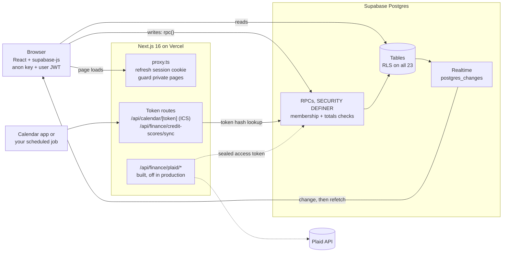

# SPLITTER

SPLITTER splits bills between housemates and tracks your own money, exact to the cent and enforced in Postgres.

[](https://github.com/neerajbhargav/splitter/actions/workflows/ci.yml)
[](LICENSE)


*Recorded on 2026-10-23 by [`e2e/demo-gif.spec.ts`](e2e/demo-gif.spec.ts) on a local Supabase stub with synthetic data: a fictional 3-person house settles in one payment, and a $90.00 bill split by days comes to $38.57, $38.57 and $12.86.*

**Status (2026-10-23):** live at [usesplitter.vercel.app](https://usesplitter.vercel.app). Sign in, then choose "Explore with sample data first" to look around without entering anything. The deployed build predates this October's changes here (CI, security headers, exact-integer weights, the memoized simplify, the Next.js 16.4.2 security update and the revoked helper functions), and Plaid bank sync is built but not enabled there. Migrations are applied by hand.

## What it does

- Splits equally, by exact amounts, percentages, shares, line items (tax and tip in proportion), or by the days each person lived there. Foreign-currency bills keep the original amounts and the rate used (the ECB rate via Frankfurter, or one you enter).
- Settles a group in at most n-1 payments, and in the fewest possible when the exact search finishes within 300,000 route combinations. Past that it falls back to greedy, which can use more ([measured](#results)).
- Syncs live across members and devices, with an activity feed, comments, receipts, recurring bills and undo.
- Tracks your own money, privately: a ledger with idempotent CSV import, budget, paychecks, accounts, debt payoff, subscriptions and credit scores.
- Reads receipts in the browser (Tesseract.js). The image never goes to an OCR service, and unclear fields stay blank.
- Connects out through a private calendar (ICS) feed, a credit-score sync token, an Apple Pay Shortcut and a bring-your-own-key AI "Ask".

Full feature reference: [docs/features.md](docs/features.md). Self-hosting: [docs/setup.md](docs/setup.md).

## Results

The receipt reader would rather leave a field blank than guess: on synthetic OCR receipts, 105 of the 106 totals it filled were right, and it left 81 of 83 unknowable dates blank.

Caveats first. Every dataset is synthetic and seeded: generated groups, rendered receipts, fictional people. Seeded counts (payments, invariant failures, authorization results) repeat on any machine. Times and receipt OCR counts can vary with the machine and its load. Times come from one Apple M4 Pro laptop under heavy load from other work (load average 8 to 19).

**Debt simplification.** Data: seeded synthetic groups (seed 1, 1 to 30 expenses each). Circle groups are built so that greedy can fail: each expense stays inside one circle of members. Code: `src/lib/debts.ts` at `f2c4679`, Node 24.17.0, 2026-10-23. Reproduce: `npm run bench:simplify -- --shape circles --min-n 4`, `npm run bench:simplify` and `node eval/compare-simplify-main.ts`. Results: [eval/results/](eval/results).

| Metric | Value | n | Baseline |
|---|---|---|---|
| Fewest payments, circle groups of 4 to 10 | 500 / 500 | 500 groups | plain greedy: 368 / 500 |
| Fewest payments, random groups of 2 to 10 (sanity check: greedy is already optimal here) | 500 / 500 | 500 groups | plain greedy: 500 / 500 |
| Invariant failures (settles everyone, no relays, at most n-1) | 0 | 1,000 groups | |
| Same payments as `main` (`108950d`) | 1,000 / 1,000 | 1,000 groups | |
| Time, circle groups | p50 0.07 ms, p95 2.6 ms, max 79 ms | 500 groups | |
| Time, random groups (slowest: 10 people) | p50 0.19 ms, p95 1.7 s, max 10.8 s | 500 groups | |

**Receipt extraction.** Data: 200 receipts rendered from SVG (seed 1). Their labels and date formats come from the set the parser supports, so the perfect-text column is a ceiling, not a baseline. Engine: tesseract.js 7.0.0, `eng` 4.0.0_best_int. Commit `40e5d16`, 2026-10-22. Reproduce: `npm run eval:receipts` and `node --test tests/receipt-held-out.test.ts`.

| Field | OCR precision (right / filled) | 95% CI | OCR coverage | Perfect-text ceiling (same metric) |
|---|---|---|---|---|
| Total | 99.1% (105/106) | 94.8 to 99.8% | 53.0% (106/200) | 100% (200/200) |
| Date | 98.6% (71/72) | 92.5 to 99.8% | 59.8% (70/117) | 100% (99/99) |
| Date left blank when unknowable | 97.6% (81/83) | | | 100% (83/83) |
| Merchant | 57.8% (100/173) | 50.4 to 64.9% | 86.5% (173/200) | 93.0% (186/200) |
| Held-out formats, perfect text | 0 wrong | | 2/12 total labels, 2/9 date formats | |

**Authorization matrix.** Generated from `pg_catalog` in PGlite, on a fresh `schema.sql` and on `schema.sql` plus the newest migrations. Commit `c4b2de1`, 2026-10-23. Reproduce: `node --test tests/authz-matrix.test.ts`.

| Check | Result |
|---|---|
| Row level security on public tables | 23 / 23 |
| `SECURITY DEFINER` functions that pin `search_path` | 74 / 74 |
| Table reads that returned a victim row, outsider and signed-out caller | 0 of 23 each |
| Outsider sending the victim's user and group ids: refused by an authorization check / answered with nothing of the victim's | 51 / 18, of 69 granted functions |
| Outsider sending its own user, group and member ids with the victim's row ids (the IDOR case): refused by an ownership or membership check / nothing of the victim's | 36 / 33, of 69 |
| Signed-out caller: refused / nothing of the victim's | 21 / 13, of 34 |
| Planted IDORs caught (a finance delete without its owner filter, a bill update without its group filter) | 2 / 2 |
| Known gaps | 0 in the repo; production still has 3 until a migration is applied ([Threat model](#threat-model)) |

Method and every caveat: [eval/README.md](eval/README.md).

## Quickstart

Needs Node 24. No keys, no network after install, no Supabase project:

```sh
git clone https://github.com/neerajbhargav/splitter && cd splitter
npm ci
npm test    # the summary shows: ℹ tests 341, ℹ pass 341, ℹ fail 0
```

`npm test` includes the database tests: it loads `supabase/schema.sql` into in-memory Postgres and calls the real RPCs. Running the app itself needs a Supabase project ([docs/setup.md](docs/setup.md)).

## How it works



The browser talks to Supabase directly with the public anon key and the user's session. Reads hit tables that row level security filters to what the user may see. Every money write is a PL/pgSQL function that checks membership or ownership and re-checks that the cents add up, so a modified client cannot save a bill that does not balance. Comments and receipt files are written directly, under RLS and Storage policies. `src/proxy.ts` only refreshes the session cookie and sends signed-out visitors to `/login`. Live sync subscribes to `postgres_changes` and refetches, debounced by 200 ms, and also refetches on tab focus and when the device comes back online. The server routes hold no service-role key: the calendar feed and the score sync look up a token hash through an RPC, and the Plaid routes answer 503 until their env vars are set.

## Design decisions

- **Integer cents and largest remainder over floating point.** Splits, weights and by-days shares are allocated in exact integer math, so parts always sum to the total and ties go to the earlier person.
- **Invariants in the database over checks in the client.** Membership, totals, item shares and currency conversions are recomputed in Postgres, because the anon key is public and the browser is not trusted.
- **PGlite tests on the real schema over mocks.** Tests load `supabase/schema.sql` into in-memory Postgres and call the real RPCs. The tests that applied migrations on top of it hid a `schema.sql`-only bug in the itemized split functions for three weeks (fixed in `9d1845b`); `tests/schema-itemized.test.ts` now runs on `schema.sql` alone.
- **A combination budget over a wall-clock cap for simplify.** The search stops after 300,000 route combinations, so every device shows the same payments for the same ledger. The cost: a 9 or 10 person group can block the page for seconds the first time a ledger renders.
- **Idempotent migrations over a migration runner.** Every migration is safe to re-run, and `tests/migrations.test.ts` applies each one twice. The cost: no version table, and migrations are pasted by hand.
- **`FOR UPDATE SKIP LOCKED` for recurring bills over a cron job.** Due copies post when anyone opens the app. If two devices open it at once, the second skips the rows the first has locked, and once the first commits those rows are no longer due. It is designed so a bill cannot post twice; PGlite has one connection, so no test races two sessions.

## Threat model

The browser is untrusted and Postgres is the enforcement point. An outsider, signed in or not, holds only the public anon key. The authorization matrix reads every table as an outsider and as a signed-out caller, and calls every granted function three ways: claiming the victim's user and group ids, sending its own ids with the victim's row ids, and signed out. A refusal counts only if an authorization check raised it.

Inside a group, members trust each other the way Splitwise users do: any member can record or edit any expense, as long as the payers and splits add up and name only group members, and every change writes an activity row. The server does not check that an equal, percent or shares split matches its weights (it does recompute itemized ones).

The matrix found 3 functions that answered outside the group. They are closed in the repo at `c4b2de1` by revoking EXECUTE, and production needs `supabase/migrations/20261023_revoke_internal_helpers.sql` applied by hand:

- `member_balance(member id)` returned that member's balance to anyone, signed in or not.
- `suggest_spot(group id)` returned, to a signed-in caller, the member id of an unclaimed spot with their first name.
- `spot_looks_like_me(member id)` told a signed-in caller whether a spot in any group matched their name or email.

Secret links are 64 hex characters from two random UUIDs, stored hashed, and revocable. The score-sync token can add scores or overwrite a score with the same bureau, day and model, including one typed in by hand; it cannot read or delete anything. The bring-your-own AI key sits in the browser's `localStorage` and the ledger summary goes from the browser to the chosen provider, so a script injection bug would expose the key. The CSP sets `frame-ancestors`, `base-uri` and `object-src` but no `script-src` yet, because Next's inline scripts need nonces first.

## Limitations

- Tests run Postgres in PGlite with a stubbed `auth.uid()`. PostgREST, JWT handling, Realtime and Storage policies are not tested against a real Supabase stack; the Playwright smoke tests use a stub server.
- Each Realtime change triggers a full refetch of the page's data. That is fine for a household, not for large groups.
- Simplify runs on the browser's main thread. On the loaded test laptop, random groups of 10 people took 5.4 s at p95 the first time; a phone is slower. Moving the search to a Web Worker would remove the freeze without changing any answer. That is not built.
- The receipt reader's labels and date formats are narrow: on formats the synthetic eval never prints, it filled 2 of 12 total labels and 2 of 9 date formats.
- Plaid sync is unit-tested with mocked HTTP only. There is no recorded run against Plaid's sandbox.
- SPLITTER records who owes whom. It never moves money.

## Repo map

```
supabase/schema.sql    tables, RLS, RPCs, realtime, storage (a fresh install runs this alone)
supabase/migrations/   idempotent upgrades for existing databases
src/proxy.ts           session refresh and route guard (Next 16 "proxy", formerly middleware)
src/lib/split.ts       money parsing and split math
src/lib/debts.ts       balances, pairwise debts, simplify
src/lib/data.ts        Supabase queries, RPC wrappers, live-refresh hook
src/lib/finance-*.ts   ledger, import, insights, sample data, BYOK AI
src/lib/plaid-*.ts     Plaid client, server helpers, token sealing
src/app/               pages and API routes
tests/                 node:test suite, PGlite harness, seeded ledgers
e2e/                   Playwright smoke tests on a Supabase stub, and the demo recorder
eval/                  receipt eval, simplify bench and main comparison, committed results
docs/                  setup, feature reference, demo GIF
```

CI ([`.github/workflows/ci.yml`](.github/workflows/ci.yml)) runs on every push and pull request with read-only permissions. The check job runs `npm audit --omit=dev --audit-level=high`, `npm run lint`, `npm run typecheck`, `npm test` (341 tests, offline, about 30 s on the runner) and `npm run build` with no env vars. The e2e job runs `npm run e2e` in the Playwright container image. The receipt OCR test is a gate: it fails if total precision or coverage drops below the committed baseline.

## License

[MIT](LICENSE)
