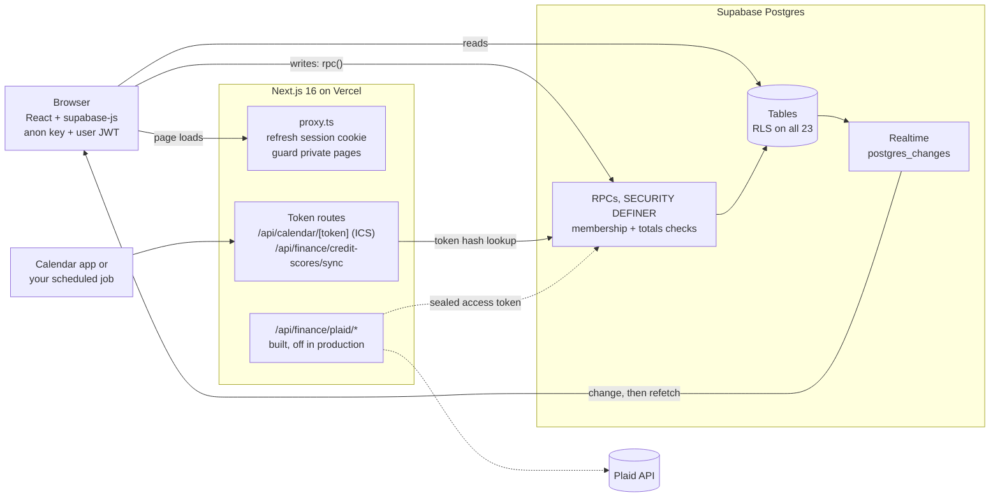

# SPLITTER

SPLITTER splits bills between housemates and tracks your own money, exact to the cent and enforced in Postgres.

[](https://github.com/neerajbhargav/splitter/actions/workflows/ci.yml)
[](LICENSE)


*Recorded on 2026-10-23 by [`e2e/demo-gif.spec.ts`](e2e/demo-gif.spec.ts), synthetic data only. Sample-data mode shows Overview, Budget and Debt. Then a fictional 3-person house (Cleo moved out on Sep 10): simplify turns 3 payments into 1, and a $90.00 internet bill split by days comes to $38.57, $38.57 and $12.86.*

**Status (2026-10-23):** live at [usesplitter.vercel.app](https://usesplitter.vercel.app) behind sign-in. The deployed build predates this October's changes here (CI, security headers, exact-integer weights, the simplify time cap), and Plaid bank sync is built but not enabled there. Migrations are applied by hand.

## What it does

- **Splits** equally, by exact amounts, percentages, shares, line items (tax and tip in proportion), or by the days each person lived there. Foreign-currency bills keep the original amounts and the ECB rate.
- **Settles** a group in at most n-1 payments, and in the fewest possible when the exact search finishes. Past 300,000 route combinations or 250 ms it falls back to greedy, which can use more ([measured](#results)).
- **Syncs live** across members and devices, with an activity feed, comments, receipts, recurring bills and undo.
- **Tracks your own money**, privately: ledger with idempotent CSV import, budget, paychecks, accounts, debt payoff, subscriptions, credit scores.
- **Reads receipts in the browser** (Tesseract.js). The image never goes to an OCR service, and unclear fields stay blank.
- **Connects out** through a private calendar (ICS) feed, a credit-score sync token, an Apple Pay Shortcut and a bring-your-own-key AI "Ask".

Full feature reference: [docs/features.md](docs/features.md). Self-hosting: [docs/setup.md](docs/setup.md).

## Results

Caveats first. Every dataset below is synthetic and seeded: generated groups, rendered receipts, fictional people. Timings come from one Apple M4 Pro laptop that had other work running (load average about 5), so treat them as rough; the counts repeat on any machine. The receipt images are rendered from SVG, not photographed, so real photos will score lower.

| Metric | Value | n | 95% CI | Baseline | Data, engine | Commit, date | Reproduce |
|---|---|---|---|---|---|---|---|
| Test suite (unit, money math, PGlite DB tests) | 328 pass, 0 fail, about 8 s, offline | 328 tests | | | [`tests/`](tests), synthetic fixtures | `ef8a46d`, 2026-10-23 | `npm test` |
| Simplify reaches the fewest payments | 1,000 / 1,000 groups | 1,000 groups | | plain greedy: 868 / 1,000 | [random groups](eval/results/simplify-bench-2026-10-22.json) 500/500 (greedy 500/500); [circle groups](eval/results/simplify-bench-circles-2026-10-22.json) 500/500 (greedy 368/500); seed 1 | `debts.ts` at `2530b66`, 2026-10-22 | `npm run bench:simplify` and `npm run bench:simplify -- --shape circles --min-n 4` |
| Simplify invariant failures (settles everyone, no relays, at most n-1) | 0 | 1,000 groups | | | same | same | same |
| Simplify time, circle groups of 4 to 10 | p50 0.02 ms, p95 0.42 ms, max 22 ms | 500 groups | | | same, Node 24.17.0 | same | same |
| Simplify time cap (250 ms) fired, random groups of 9 to 10 | 53 of 104 groups; all 53 kept the same payment count when rerun with no cap | 104 groups | | | same | same | `npm run bench:simplify -- --compare` |
| Receipt total, OCR: precision | 99.1% (105/106) | 200 receipts | 94.8 to 99.8% | perfect text: 100% (200/200) | [synthetic receipts](eval/results/receipts-2026-10-22.json), seed 1; tesseract.js 7.0.0, eng `4.0.0_best_int` | `40e5d16`, 2026-10-22 | `npm run eval:receipts` |
| Receipt total, OCR: coverage | 53.0% (106/200) | 200 receipts | | perfect text: 100% | same | same | same |
| Receipt date, OCR: precision / refusal on unknowable dates | 98.6% (71/72) / 97.6% (81/83) | 200 receipts | 92.5 to 99.8% (precision) | perfect text: 100% / 100% | same | same | same |
| Receipt merchant, OCR: precision | 57.8% (100/173) | 200 receipts | 50.4 to 64.9% | perfect text: 93.0% (186/200) | same | same | same |
| Authorization matrix | RLS on 23/23 tables; 74/74 `SECURITY DEFINER` functions pin `search_path`; an outsider calling all 72 granted functions is refused or gets nothing of the victim's in 69, and 3 are known gaps (see [Threat model](#threat-model)) | 72 functions, 23 tables | | | [`tests/authz-matrix.test.ts`](tests/authz-matrix.test.ts), generated from `pg_catalog` | `ef8a46d`, 2026-10-23 | `node --test tests/authz-matrix.test.ts` |

On "fewest payments": in plain random groups, greedy already reaches the minimum, so those 500 groups say nothing about the exact search. The circle groups (couples or sub-trips whose costs stay inside the circle) are where it matters: greedy misses the minimum in 132 of 500 and the exact search finds it in all 500. A 2 ms cap, standing in (by assumption) for a device about 100 times slower, made 5 circle groups fall back, and all 5 still hit the minimum ([results](eval/results/simplify-bench-circles-cap2-2026-10-22.json)). Rerunning both benches on 2026-10-23 gave the same counts, except the time cap fired in 54 random groups instead of 53. Method and every caveat: [eval/README.md](eval/README.md).

## Quickstart

No keys, no network after install, no Supabase project:

```sh
git clone https://github.com/neerajbhargav/splitter && cd splitter
npm ci
npm test    # ends with: ℹ tests 328, ℹ pass 328, ℹ fail 0
```

`npm test` includes the database tests: it loads `supabase/schema.sql` into in-memory Postgres and calls the real RPCs. Running the app itself needs a Supabase project ([docs/setup.md](docs/setup.md)).

## How it works



The browser talks to Supabase directly with the public anon key and the user's session. Reads hit tables that row level security filters to what the user may see. Every write is a PL/pgSQL function that checks membership or ownership and re-checks that the cents add up, so a modified client cannot save a bill that does not balance. `src/proxy.ts` only refreshes the session cookie and sends signed-out visitors to `/login`. Live sync subscribes to `postgres_changes` and refetches, debounced by 200 ms, and also refetches on tab focus and when the device comes back online. The server routes hold no service-role key: the calendar feed and the score sync look up a token hash through an RPC, and the Plaid routes answer 503 until their env vars are set.

## Engineering decisions

- **Integer cents and largest remainder over floating point.** Splits, weights and by-days shares are allocated in exact integer math, so parts always sum to the total and ties go to the earlier person.
- **Invariants in the database over checks in the client.** Membership, totals, item shares and currency conversions are recomputed in Postgres, because the anon key is public and the browser is not trusted.
- **PGlite tests on the real schema over mocks.** Tests load the same `supabase/schema.sql` a fresh install runs, so a broken function or policy fails `npm test`. This caught a `schema.sql`-only bug in the itemized split functions (fixed in `9d1845b`).
- **Idempotent migrations over a migration runner.** Every migration is safe to re-run, and the test harness applies each one twice. The cost: no version table, and migrations are pasted by hand.
- **`FOR UPDATE SKIP LOCKED` for recurring bills over a cron job.** Due copies post when anyone opens the app. If two devices open the app at once, the second skips the rows the first has locked, and once the first commits those rows are no longer due, so a bill never posts twice.
- **Hashed and sealed secrets over plaintext.** Calendar and score-sync tokens are stored only as SHA-256 hashes. Plaid access tokens are sealed with AES-256-GCM, bound to `user:item`, in a table the browser cannot read.

## Threat model

The browser is untrusted and Postgres is the enforcement point. An outsider, signed in or not, holds only the public anon key, and the authorization matrix aims every table and every granted function at another user's data. Inside a group, members trust each other the way Splitwise users do: any member can record or edit any expense, as long as the payers and splits add up and name only group members, and every change writes an activity row. The server does not check that an equal, percent or shares split matches its weights (it does recompute itemized ones). The matrix found 3 functions that answer outside the group to anyone who knows a member id: `member_balance` (that member's balance), `suggest_spot` and `spot_looks_like_me` (whether an unclaimed spot's first name matches yours). The app does not call them directly, and revoking their EXECUTE grant would close all 3, but that is a production SQL change not yet made. Secret links are 64 hex characters from two random UUIDs, stored hashed, and revocable; the score-sync token can only add scores. The bring-your-own AI key sits in the browser's `localStorage` and the ledger summary goes from the browser to the chosen provider, so a script injection bug would expose the key. The CSP sets `frame-ancestors`, `base-uri` and `object-src` but no `script-src` yet, because Next's inline scripts need nonces first.

## Limitations

- Tests run Postgres in PGlite with a stubbed `auth.uid()`. PostgREST, JWT handling, Realtime and Storage policies are not tested against a real Supabase stack; the Playwright smoke tests use a stub server.
- Each Realtime change triggers a full refetch of the page's data. That is fine for a household, not for large groups.
- Simplify runs on the browser's main thread. The 250 ms cap bounds it, and a capped answer can differ between a fast and a slow device.
- Plaid sync is unit-tested with mocked HTTP only. There is no recorded run against Plaid's sandbox.
- SPLITTER records who owes whom. It never moves money.

## Repo map

```
supabase/schema.sql    tables, RLS, RPCs, realtime, storage (a fresh install runs this alone)
supabase/migrations/   idempotent upgrades for existing databases
src/proxy.ts           session refresh and route guard (Next 16 "proxy", formerly middleware)
src/lib/split.ts       money parsing and split math
src/lib/debts.ts       balances, pairwise debts, simplify
src/lib/data.ts        Supabase queries, RPC wrappers, live-refresh hook
src/lib/finance-*.ts   ledger, import, insights, sample data, BYOK AI
src/lib/plaid-*.ts     Plaid client, server helpers, token sealing
src/app/               pages and API routes
tests/                 node:test suite, PGlite harness, seeded ledgers
e2e/                   Playwright smoke tests on a Supabase stub, and the demo recorder
eval/                  receipt eval, simplify bench, committed results
docs/                  setup, feature reference, demo GIF
```

CI ([`.github/workflows/ci.yml`](.github/workflows/ci.yml)) runs on every push and pull request with read-only permissions: `npm run lint`, `npm run typecheck`, `npm test` and `npm run build` with no env vars, then `npm run e2e` in a second job. The receipt OCR test is a gate: it fails if total precision or coverage drops below the committed baseline.

## License

[MIT](LICENSE)
